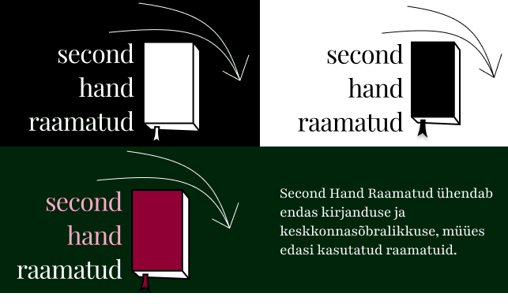

# Website - Second-Hand Raamatud

## Purpose  
This website was created in 12th grade of highschool as part of a course for creating online shops. "Second-Hand Raamatud" translates to "second-hand books", which was precicely the point of my website - to resell used books online. Personally, I really encourage the idea of green economy and see it becoming the future trend. Let it be stated, though, that the book-selling part of this project was merely fictional. The main objective was to learn to create a web-store through Wordpress.

## Skills
Creating a website that can be used as a shop needed the following:
* domain hosting in zone.ee  
The domain was secondhandraamatud.eu and zone.ee provided an environment for managing the virtual server behind it.
* Wordpress  
This inludes Wordpress setup, creating pages and its many plug-ins, that are counted in the list.
* Elementor  
With Elementor, I could control the appearance of my website, be it choosing the font, applying colour themes or organizing the layout.
* logo  
Of course, I had to design a logo fitting for the purpose of the website, and implement it in the website itself.

